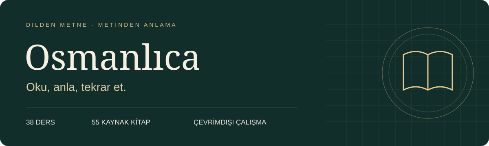

<p align="center"></p>
<p align="center"><strong>Osmanlıca öğrenmek için dersler, kitaplar ve sözlük içeren iPhone uygulaması.</strong></p>

## Önce bunu bil

**Bu uygulama iPhone'a bir dosyaya dokunarak kurulmaz.** Bu sayfada uygulamanın kaynak projesi paylaşılır. Kurulum için **Apple Silicon işlemcili bir Mac (M serisi), Xcode ve iOS 26 veya üzeri bir iPhone** gerekir. Yalnızca iPhone'un varsa aşağıdaki yöntemle kurulum yapamazsın.

Xcode, Apple'ın uygulama geliştirme programıdır. Projeyi bu programda açıp kendi Apple hesabınla telefonuna yükleyeceksin. Ücretsiz Apple hesabıyla kurulumda **7 günde bir Xcode üzerinden yeniden yükleme** gerekir.

## 1. Hangi dosyayı indireceğim?

**İlk kez kuruyorsan yalnızca aşağıdaki ilk dosyayı indirerek başla:**

### [⬇ Uygulamayı kurmak için gereken dosyayı indir — 1,90 GB](https://github.com/BossP4nd4/Osmanlica-Ogren/releases/download/v1.0.0-arsiv.20261015/01-kaynak-kod-ve-kilavuzlar.zip)

Dosyanın adı: `01-kaynak-kod-ve-kilavuzlar.zip`. İçinde uygulamanın Xcode projesi, dersler, 55 kitap ve ayrıntılı kurulum kılavuzları var.

| Diğer dosya | İndirmem gerekiyor mu? |
| --- | --- |
| [02-sozluk-paketi.zip — 413 MB](https://github.com/BossP4nd4/Osmanlica-Ogren/releases/download/v1.0.0-arsiv.20261015/02-sozluk-paketi.zip) | **Sözlük kullanmak istiyorsan indir.** Önce uygulamayı kur; sonra aşağıdaki sözlük adımlarını uygula. |
| [03-hazir-ipa.zip — 1,73 GB](https://github.com/BossP4nd4/Osmanlica-Ogren/releases/download/v1.0.0-arsiv.20261015/03-hazir-ipa.zip) | **İlk kurulum için gerekmez.** Eski hesapla imzalanmış uygulama arşividir; indirip dokunarak kendi telefonuna kuramazsın. |
| PAKETLERI_AC.py, SHA256SUMS.txt, DOSYA-ENVANTERI.json | **Normal kurulum için gerekmez.** Tam arşivi açmak ve dosyaları kontrol etmek isteyenler içindir. |
| Source code (zip), Source code (tar.gz) | **Bunları indirme.** GitHub'ın otomatik oluşturduğu bu dosyalar büyük uygulama paketini içermez. |

> Yukarıdaki büyük indirme bağlantısı doğrudan doğru dosyayı indirir. Yeşil **Code → Download ZIP** düğmesini kullanma.

## 2. İndirdiğim ZIP'i nasıl açacağım?

1. Mac'te **Finder → İndirilenler** klasörüne git.
2. `01-kaynak-kod-ve-kilavuzlar.zip` dosyasına çift tıkla ve açılmasını bekle.
3. Açılan dosyaların içinde **01-Sifirdan-Kurulum** klasörünü bul. Finder bir üst klasör oluşturduysa önce onun içine gir.
4. Sırasıyla **Yeniden-Derleme → Proje** klasörlerini aç.
5. Buradaki **Osmanlica.xcodeproj** dosyası bir sonraki adımda açacağın projedir.

Aradığın dosyanın yolu:

```text
01-Sifirdan-Kurulum → Yeniden-Derleme → Proje → Osmanlica.xcodeproj
```

**Klasörün içindeki dosyaları tek tek taşıma.** Projeyi, açılmış klasör yapısı korunarak kullan.

## Kurulum

### 3. Uygulamayı iPhone'a nasıl yükleyeceğim?

1. **Mac App Store'dan Xcode'u kur.** İlk kez açıp istediği bileşenlerin kurulumunu tamamla. Xcode'un telefonundaki iOS sürümünü desteklemesi gerekir. Mac'te yaklaşık **35–50 GB boş çalışma alanı** ayır.
2. Önceki adımda bulduğun **Osmanlica.xcodeproj** dosyasına çift tıklayarak Xcode'da aç.
3. Üst menüden **Xcode → Settings → Apple Accounts** bölümüne gir ve kendi Apple hesabını ekle.
4. Xcode'un sol tarafında en üstteki mavi **Osmanlica** proje simgesine tıkla. Ortadaki **TARGETS** listesinden **Osmanlica** öğesini seç, ardından **Signing & Capabilities** sekmesini aç.
5. **Automatically manage signing** kutusunu işaretle. **Team** alanında kendi hesabını (**Personal Team**) seç. **Bundle Identifier** alanına sana özel bir ad yaz; örneğin `com.adinsoyadin.osmanlica`. Bu ad uygulamanın telefonundaki kimliğidir; sonraki yüklemelerde aynı bırak.
6. iPhone'unu veri aktarabilen bir kabloyla Mac'e bağla. Telefonda **Bu bilgisayara güven** sorusu çıkarsa onayla. Gerekirse **Ayarlar → Gizlilik ve Güvenlik → Geliştirici Modu** seçeneğini aç ve telefonun yönergelerini tamamla.
7. Xcode'un üst kısmında çalıştırılacak uygulama olarak **Osmanlica**, cihaz olarak **kendi iPhone'unu** seç. **▶ Run** düğmesine bas veya **⌘R** tuşlarına bas. Derleme ve telefona aktarımın bitmesini bekle.
8. Telefonda Osmanlıca açıldığında bir dersi ve bir kitabı açarak kontrol et.

**Beklenen sonuç:** iPhone'unda Osmanlıca uygulaması açılır; dersler ve kitaplar kullanılabilir. Sözlük için aşağıdaki ek adım gerekir.

> Bu kaynak arşivinin hazırlık kayıtlarında ücretsiz Personal Team ile gerçek iPhone kurulumu test edilmemiştir. Yukarıdaki yol kurulum yönergesidir; her cihazda hatasız çalıştığı doğrulanmış değildir. Bir adımda hata alırsan [ayrıntılı kılavuza](KURULUM-KILAVUZU.txt) bak veya [sorun bildir](https://github.com/BossP4nd4/Osmanlica-Ogren/issues).

### 4. Sözlüğü de istiyorum — ne yapacağım?

Bu bölüm **isteğe bağlıdır**. Önce uygulamanın telefonunda açıldığından emin ol.

1. [Sözlük paketini indir](https://github.com/BossP4nd4/Osmanlica-Ogren/releases/download/v1.0.0-arsiv.20261015/02-sozluk-paketi.zip). Mac'te bu ZIP'e çift tıkla.
2. Açılan klasörler içinde **01-Sifirdan-Kurulum → Sozluk-Paketi** yoluna git. `Sozluk-Paketi` klasöründe **dictionary-install.json**, **Lexicons** ve **Sources** birlikte bulunmalı. Bu klasörü ilk indirdiğin projenin içine taşıman gerekmez.
3. Mac'te **Sozluk-Paketi** klasörüne sağ tıkla → **Sıkıştır**. Oluşan ZIP'i, iPhone bağlıyken Finder'da **iPhone'un → Dosyalar → Osmanlıca** bölümüne sürükle.
4. iPhone'da **Dosyalar** uygulamasını aç. Aktardığın ZIP'i bul ve dokunarak aç.
5. Osmanlıca uygulamasında **Sözlük → Sözlük paketini kur → Kurulum klasörünü seç** yolunu izle.
6. İçinde **dictionary-install.json**, **Lexicons** ve **Sources** bulunan klasörü seç; ön kontrolün ardından kurulumu başlat.
7. Sözlükte `kitab` araması yap. `kitâb` sonucunu ve kaynak sayfasını açabiliyorsan sözlük kurulmuştur.

## Sık sorulanlar

**Mac'im yok. Sadece iPhone'dan kurabilir miyim?**  
Bu sayfadaki kurulum yöntemi Mac ve Xcode gerektirir.

**Üç ZIP'i de indirmem gerekiyor mu?**  
Hayır. Uygulamayı kurmak için **01** yeterlidir. Sözlük için ayrıca **02** gerekir. **03**, normal kurulumun parçası değildir.

**Uygulama bir hafta sonra açılmazsa?**  
Ücretsiz Apple hesabıyla imzalama süresi 7 gündür. Aynı proje, Apple hesabı ve Bundle Identifier ile telefonu Xcode'a bağlayıp yeniden **⌘R** ile yükle. Uygulamayı silmeden önce ilerlemeni yedekle. [Apple'ın açıklaması](https://developer.apple.com/help/account/basics/about-your-developer-account).

**Kurulumda hata aldım. Ne göndereyim?**  
[Issues sayfasına](https://github.com/BossP4nd4/Osmanlica-Ogren/issues) takıldığın adımı, hata mesajını ve macOS/Xcode/iOS sürümlerini yaz. Parola veya doğrulama kodu paylaşma.

## Uygulamada neler var?

- 38 ders ve 870 çalışma grubu.
- 55 PDF kitap ve özgün kaynak sayfaları.
- Aralıklı tekrar, notlar, yer imleri ve ilerleme yedeği.
- Ayrı kurulabilen sözlük: 10.294 arama kaydı ve 3 kaynak PDF.

Bu sayılar 15 Ekim 2026 arşivine aittir. Sözlük bütün PDF'lerin tam metin araması değildir. Hazır içerikler ve kurulmuş sözlükler çevrimdışı kullanılabilir.

## Ayrıntılı belgeler

- [Kurulum ve sorun giderme kılavuzu](KURULUM-KILAVUZU.txt)
- [Şematik görseller içeren PDF kılavuzu](Osmanlica-Kisisel-Kurulum-Kilavuzu.pdf)
- [Tüm indirme dosyaları](https://github.com/BossP4nd4/Osmanlica-Ogren/releases/tag/v1.0.0-arsiv.20261015)

<details>
<summary><strong>Tam arşiv, dosya doğrulaması ve teknik ayrıntılar</strong></summary>

Bu bölüm yalnızca bütün arşivi saklamak veya bütünlüğünü doğrulamak isteyenler içindir. Yukarıdaki normal kurulum için gerekli değildir.

Üç ZIP'i ve [PAKETLERI_AC.py](https://github.com/BossP4nd4/Osmanlica-Ogren/releases/download/v1.0.0-arsiv.20261015/PAKETLERI_AC.py) dosyasını aynı klasöre indir. Python 3 kurulu Mac'te Terminal'i bu klasörde açıp `python3 PAKETLERI_AC.py` komutunu çalıştır. Araç üç paketin SHA-256 değerlerini doğrular, sonra yeni bir `Osmanlica-Kurulum` klasörüne açar; mevcut klasörün üzerine yazmaz.

[Paket hash değerleri](SHA256SUMS.txt) · [2.585 dosyanın envanteri](DOSYA-ENVANTERI.json)

Paketlerin içerikleri kaynak dosyalarla SHA-256 düzeyinde karşılaştırıldı. Yeniden açılan arşivde özgün denetleyici 2.580 kayıtlı dosyada sıfır fark buldu. Xcode'da proje ayarları değiştirildiğinde ilgili dosyaların hash değerlerinin değişmesi normaldir.

Arşivin sürüm kaydı Xcode 27.0 ve macOS 26.6.2 belirtir. Xcode ve Apple SDK'ları pakete dahil değildir. Hazır yerel kütüphaneler Apple Silicon içindir; normal kurulumda ayrıca Rust kurmak gerekmez. Ücretsiz kurulum kopyasında paylaşım uzantısı ve App Groups kapalıdır. Simülatör ile telefon ilerlemesi kendiliğinden eşitlenmez.

Bu yayın `00-BURADAN-BASLA.txt`, `PAKET-OZETI.json` ve `01-Sifirdan-Kurulum` klasörünü içerir. Özgün başlangıç notundaki 02–06 klasörleri bu yayının kapsamında değildir. `PAKET-OZETI.json` daha geniş özgün arşivin özetidir; bu yayının kapsamı için dosya envanterini esas al. Uygulama arşivi kişisel çalışma ilerlemesinin yedeği değildir.

</details>
